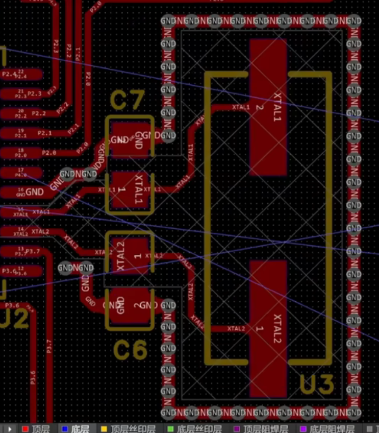

# PCB 布线

## 一、布线规则

### 1. 顶层优先

- 优先在顶层减少过孔，同时信号路径最短。
- 顶层通常紧邻完整地平面，能提供较好的参考面。
- 便于调试，万用表、探针等更容易接触顶层的走线和元件。
- 当板子层数增加、有特殊元件或者需要进行电源处理时会牺牲部分顶层布线。

### 2. 其他要点

1. **电源线加粗**
2. 同一层内走线大于 90 度
3. **电容排放的基本方式**：进芯片先大再小，出芯片先小再大。
4. **高频线**尽可能短并与其他信号屏蔽隔离，尽量避免相邻层平行走线，线与线之间的距离大于等于 3 倍线宽，相邻层采用正交方向，差分线布线尽量等距等长
5. 尽量远离安装孔和板边
6. 添加泪滴
7. 晶振外过孔包地并在晶振电路下方设置禁止铺铜
8. 元件内部尽量不走线
9. **在元件GND附近打过孔连接到地平面，尤其是晶振、去耦电容等高频器件以及一些需要散热的芯片**

::: tip 第 7 点示例：晶振包地与禁止铺铜

*图 1：C6 / C7 为晶振负载电容，沿 U3 外围一圈的 GND 过孔构成包地，晶振下方区域禁止铺铜*
:::

::: info DeepSeek 补充
第 2 条「同一层内走线大于 90 度」通常指**避免拐角小于等于 90° 的锐角/直角转弯**（俗称锐角走线），建议用 **135°（钝角）或圆弧**过渡，以减少阻抗突变和信号反射。
:::

## 二、布线顺序

1. **密度优先**：从最密集的地方开始布线。
2. **关键元器件优先**：OOR、射频等核心部分优先布线，信号传输线等提供专层、电源地回路，其他次要信号顾全整体。
3. **关键信号线优先**：电源、模拟小信号、高速信号、时钟信号、同步等长信号优先。